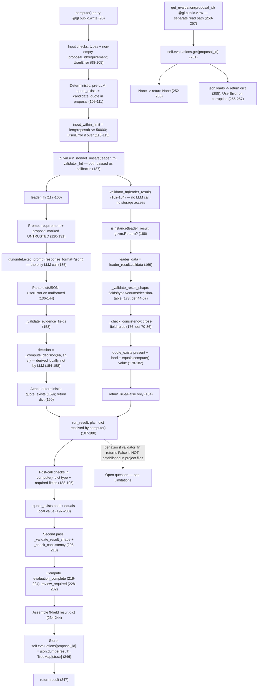

# Procurement Evidence Verifier (PEV)

An Intelligent Contract for GenLayer that evaluates whether a vendor proposal contains textual evidence supporting procurement specification requirements.

## Project Overview

PEV (Procurement Evidence Verifier) is a GenLayer Intelligent Contract prototype designed to evaluate procurement proposals against specification requirements. The contract determines whether submitted textual evidence in a proposal supports, partially supports, contradicts, or fails to establish each requirement.

## Problem Statement

Procurement teams manually review vendor proposals to verify compliance with specification requirements. This process is time-consuming and prone to human inconsistency. PEV automates the evidence evaluation step, providing a structured, deterministic decision output based on LLM-assisted semantic evaluation and storage of results in contract state.

## Why PEV Matters

- **Deterministic decision logic**: The final decision (accept / reject / review) is computed deterministically inside the contract from the LLM-evaluated evidence fields, not by the LLM directly.
- **Deterministic quote verification**: The contract checks whether a candidate quote exists verbatim in the proposal text, independent of LLM output.
- **Contract-state storage**: Evaluation results are stored in contract state as JSON-serialized records, keyed by proposal ID. (Whether this state resides on-chain depends on the deployment environment; this repository contains no deployment record that establishes on-chain storage.)
- **No compliance claims**: The contract records evidence characteristics only; it does not certify real-world compliance, legal validity, or security.

## Architecture



### Contract State

| Field | Type | Description |
|-------|------|-------------|
| `evaluations` | `TreeMap[str, str]` | Persistent storage mapping proposal_id to JSON-serialized result |

### Contract Methods

| Method | Decorator | Parameters | Returns |
|--------|-----------|------------|---------|
| `compute` | `@gl.public.write` | `proposal_id`, `requirement`, `proposal`, `candidate_quote` | `dict` with evaluation result |
| `get_evaluation` | `@gl.public.view` | `proposal_id` | `dict` (stored result), or `None` if no result is stored; raises `gl.vm.UserError` if the stored JSON is corrupted |

## How It Works

### 1. Input Validation

All inputs (`proposal_id`, `requirement`, `proposal`, `candidate_quote`) are validated as strings where required. `proposal_id` and `requirement` must be non-empty. `candidate_quote` may be empty. `proposal` must be at most 50,000 characters (`MAX_PROPOSAL_LENGTH`); `compute()` raises `gl.vm.UserError("proposal exceeds maximum length")` when it exceeds the limit.

### 2. Deterministic Quote Check (`quote_exists`)

The contract checks whether `candidate_quote` appears as a literal substring in `proposal`. This check is:
- **Deterministic**: Same inputs always produce the same result
- **Independent**: Computed outside the LLM prompt
- **Non-conclusive**: `quote_exists=False` does not mean no other evidence exists in the proposal

### 3. Leader Function (Semantic Evaluation)

The leader executes `gl.nondet.exec_prompt()` with a structured prompt that:
- Presents the requirement and proposal as untrusted data
- Explicitly instructs the LLM to ignore any instructions embedded in the proposal
- Requests JSON output with: `evidence_assessment`, `semantic_relevance`, `evidence_found`, `explanation`
- Explicitly states: "Do not return a decision field; the contract derives it deterministically"

### 4. Validator Function (Deterministic Structural Verification)

The validator receives the leader's result as a `gl.vm.Return` object and reads the payload from its `.calldata` attribute. Its explicit checks:

1. The argument is a `gl.vm.Return` (otherwise it returns `False`).
2. `.calldata` is readable (failure returns `False`).
3. Result shape: the payload is a dict with `evidence_assessment`, `semantic_relevance`, `evidence_found`, and `decision`; field types and allowed enum values are checked, and `explanation` is checked to be a string within the length limit (type/length check only, not a semantic check).
4. Decision-table consistency: `decision` must equal the value the deterministic decision table computes from the other fields.
5. Cross-field consistency rules (e.g. `supported` requires `evidence_found = true` and cannot combine with `irrelevant`).
6. `quote_exists` must be present, must be a boolean, and must equal the deterministic value computed in `compute()` before the nondeterministic execution.

The validator returns a single boolean verdict: `True` only if all checks pass; each explicit failure branch returns `False` without raising. It does not issue a second LLM call and does not read or write contract storage. It validates structure and internal consistency; it does not independently re-derive or fact-check the semantic assessment.

### 5. Finalization in `compute()`

`compute()` calls `gl.vm.run_nondet_unsafe(leader_fn, validator_fn)`, passing both functions as callbacks to the nondeterministic execution wrapper. The leader's result reaches the two sides in different forms:

- Inside `validator_fn` it arrives wrapped as a `gl.vm.Return` and is read via `.calldata`.
- `compute()` receives `run_result` as a plain `dict`.

`compute()` then re-validates the result deterministically before assembling anything to store: it checks that `run_result` is a dict containing the required fields, that `quote_exists` is a boolean equal to the value `compute()` itself computed, and re-runs the shape and consistency checks. Only then are `evaluation_complete` and `review_required` computed, the final result dict assembled, the result stored as JSON in `TreeMap[str, str]`, and the dict returned.

This section documents the contract code only. It does not state how the GenLayer runtime reacts when `validator_fn` returns `False`; that behavior is not established by this repository.

## Decision Logic

The contract uses a deterministic decision table computed inside the contract (not by the LLM):

| evidence_assessment | semantic_relevance | evidence_found | decision |
|---------------------|-------------------|----------------|----------|
| supported | relevant | true | **accept** |
| contradicted | any | any | **reject** |
| any | irrelevant | any | **reject** |
| supported | relevant | false | **review** |
| partial | any | any | **review** |
| insufficient | any | any | **review** |
| ambiguous | any | any | **review** |

The `decision` field is computed locally by the contract, not returned by the LLM. This prevents LLM output variance from affecting the `decision` field itself; which table row applies still depends on the LLM-evaluated fields, so variance in those fields can change the outcome.

## Evidence Assessment

| Status | Meaning |
|--------|---------|
| `supported` | Evidence clearly satisfies the requirement |
| `partial` | Evidence addresses part of the requirement |
| `contradicted` | Evidence directly contradicts the requirement |
| `insufficient` | Evidence relevant but doesn't establish the requirement |
| `ambiguous` | Requirement or evidence too ambiguous to judge |

### Semantic Relevance Values

`semantic_relevance` is one of three values (contract: `ALLOWED_RELEVANCE`):

| Value | Effect in the decision table |
|-------|------------------------------|
| `relevant` | Required, together with `supported` and `evidence_found=true`, for `accept` |
| `irrelevant` | Always results in `reject`, regardless of the other fields |
| `uncertain` | Does not enable `accept` and does not by itself force `reject`; with a non-`contradicted` assessment it falls through to `review` |

### Result Flags: `evaluation_complete` and `review_required`

Both are computed deterministically inside `compute()` from the validated result fields:

- **`evaluation_complete`** is `True` only when all four result fields are within their allowed domains: `evidence_assessment` is an allowed status, `semantic_relevance` is an allowed value, `evidence_found` is a boolean, and `decision` is an allowed decision value. It is a field-domain check; it does not verify factual correctness of the evaluation.
- **`review_required`** is `True` when the evaluation is incomplete, or when `decision` is `review`, or when `evidence_assessment` is `insufficient` or `ambiguous`. A clear `reject` (for example, contradicted evidence) does not by itself set `review_required`.

## Equivalence Principle

GenLayer's equivalence principle requires nondeterministic code paths to be checkable by validators; this repository's code is written to keep the validator itself deterministic, so that a validator re-run on the same inputs produces the same verdict. What the code establishes:

1. **Deterministic fields**: `quote_exists`, `input_within_limit`, `evaluation_complete`, `review_required` are computed deterministically inside `compute()` from the inputs, not from LLM output.
2. **The LLM supplies evidence fields only**: `evidence_assessment`, `semantic_relevance`, `evidence_found`, and `explanation` are produced by the LLM. The validator checks their structure, allowed values, and internal consistency against the decision table; `explanation` is type/length checked only. No code in this contract compares LLM outputs across runs or across validators, and the contract does not claim to prove equivalence at the runtime level.
3. **Decision derived locally**: The `decision` field is never returned by the LLM; it is computed by the contract from the evidence fields using a deterministic table.

What this section does not claim: that all validator outputs are identical across validators (the contract defines a single validator and no code compares validator outputs), or that the runtime provides specific consensus guarantees.

## Testing Results

### Deterministic Tests (Execution Status Not Verified by Repository Evidence)

`tests/test_pev_direct.py` contains six tests that do not require the GenLayer runtime:

| # | Test | What it tests |
|---|------|---------------|
| 1 | `test_quote_exists_true` | Substring logic mirroring the `quote_exists` computation in `compute()` |
| 2 | `test_quote_exists_false` | Substring logic mirroring the `quote_exists` computation in `compute()` |
| 3 | `test_empty_quote` | Empty-quote case mirroring the `quote_exists` computation |
| 4 | `test_input_within_limit` | Length-limit comparison mirroring `input_within_limit` |
| 5 | `test_evaluation_complete_from_fields` | Illustrative re-implementation of a field-presence check (see note 3) |
| 6 | `test_evaluation_complete_missing_field` | Illustrative re-implementation of a field-presence check (see note 3) |

**Execution status — not verified by repository evidence:**

1. No execution log, CI artifact, or other execution record is committed to this repository, so in-repo execution cannot be verified from repository contents alone.
2. A session handoff record reports that these six deterministic tests were executed and passed; that record is external to the repository and cannot be re-verified from it. This README therefore makes no PASS claims.
3. The test file's docstring carries the same status description (see `tests/test_pev_direct.py`).
4. Tests 5 and 6 re-implement the check as a field-presence test (`is not None`) and do **not** import or exercise the contract's actual `evaluation_complete` logic, which checks allowed values (e.g. `evidence_assessment in ALLOWED_STATUSES`), not mere presence. Their docstring says they are "illustrative only" and "do not constitute validation of GenLayer contract behavior."

This section therefore does not present these tests as verified passing repository evidence.

### Tests Not Executed (Require the `genlayer` Package for Import)

4 deterministic logic tests were identified but **not executed** because they require importing `PEVContract` from `contracts.pev_contract.py`, which depends on the `genlayer` package that is not available in this environment:

- `test_compute_decision_accept`
- `test_compute_decision_reject_contradicted`
- `test_compute_decision_reject_irrelevant`
- `test_compute_decision_review`

### Manual Studio Test Plan (Not Executed)

The following 13 test cases are documented in `docs/manual_studio_test_plan.md` and require a running GenLayer Studio environment with validator nodes:

| # | Test Case | Expected Outcome |
|---|-----------|------------------|
| 1 | ACCEPT — Direct supporting evidence | `evidence_assessment="supported"`, `decision="accept"` |
| 2 | REJECT — Contradictory evidence | `evidence_assessment="contradicted"`, `decision="reject"` |
| 3 | REVIEW — Partial support | `evidence_assessment="partial"`, `decision="review"` |
| 4 | Fabricated quote | `quote_exists=False` |
| 5 | Quote from unrelated section | `quote_exists=True`, `evidence_assessment="insufficient"` |
| 6 | Prompt injection — false positive | `quote_exists=True`, `evidence_assessment` based on LLM eval |
| 7 | Prompt injection — fabricated quote | `quote_exists=False` (not in proposal text) |
| 8 | Conflicting evidence | `quote_exists=True`, `evidence_assessment` based on LLM eval |
| 9 | Malformed LLM response | `gl.vm.UserError` raised; `compute()` aborts, so no evaluation result (and thus no `review_required` value) is stored for that execution |
| 10 | Missing required fields | `gl.vm.UserError` raised |
| 11 | Validator disagreement | Intended to observe runtime behavior when a validator verdict is `False`; this is **not** established by the contract code or by available tests and requires empirical verification against a running GenLayer runtime |
| 12 | Oversized proposal | `gl.vm.UserError("proposal exceeds maximum length")` |
| 13 | Ambiguous requirement | `evidence_assessment="ambiguous"`, `decision="review"` |

> **Note on Test Cases 9 and 11:** The outcomes above match `docs/manual_studio_test_plan.md`: Test Case 9 expects no stored evaluation result (and therefore no stored `review_required`) when `UserError` aborts `compute()`, and Test Case 11 is documented as an open observation of GenLayer runtime behavior that requires empirical verification. Both files were corrected to this state.

### Test Status Summary

| Category | Count | Status |
|----------|-------|--------|
| Deterministic tests (no runtime needed) | 6 | Not verified by repository evidence — see status note above |
| Tests not executed (require GenLayer runtime) | 4 | Pending `genlayer` package availability |
| Manual Studio Test Plan | 13 | Pending GenLayer Studio environment |

**Test framework**: Python standard-library `unittest` (`tests/test_pev_direct.py`).

## Installation and Usage

### Prerequisites

- Python 3.14+
- GenLayer SDK (`genlayer` package) — availability for Python 3.14.6 on Android Termux not verified
- `gltest` CLI tool — availability not verified

### Installation

Dependencies are not pinned in `requirements.txt` because the GenLayer SDK (`genlayer`) and testing tool (`gltest`) have not been verified for availability or compatibility with Python 3.14.6 on this environment. Refer to official GenLayer documentation for installation instructions.

### Contract Deployment

Deployment commands are not documented here because the official GenLayer deployment procedure has not been verified in this environment. Refer to official GenLayer documentation.

### Contract Invocation (API-shape reference only)

The example below shows the call shape. It is **not** a verified local invocation: `compute()` calls `gl.nondet.exec_prompt`, which requires a GenLayer runtime, so plain local Python execution of this example is not verified in this environment.

```python
from contracts.pev_contract import PEVContract

contract = PEVContract()
result = contract.compute(
    proposal_id="PROP-001",
    requirement="System shall use AES-256 encryption at rest",
    proposal="We implement AES-256 encryption for data at rest.",
    candidate_quote="AES-256 encryption at rest"
)
print(result)
```

### Retrieving an Evaluation (API-shape reference only)

Same caveat: `get_evaluation` reads contract state, which is maintained by the GenLayer runtime.

```python
result = contract.get_evaluation("PROP-001")
print(result)
```

## Limitations

1. **GenLayer SDK dependency**: The `genlayer` package has not been verified as available for Python 3.14.6 on Android Termux.
2. **Android Termux compatibility**: Not verified for ARM architecture.
3. **No formal security audit**: This contract has not undergone professional security review.
4. **Single requirement per evaluation**: Each `compute()` call evaluates one requirement against one proposal.
5. **No batch evaluation**: Multiple requirements require multiple contract calls.
6. **LLM-based semantic evaluation**: The `evidence_assessment`, `semantic_relevance`, and `evidence_found` fields are produced by an LLM and may vary between executions; they are validated for structure and consistency but not for factual correctness.

## License

The license for this project has not been determined. No LICENSE file is included.

---

**Important**: This contract evaluates textual evidence only. It does not certify real-world compliance, legal validity, or security of vendor proposals. All evaluations are subject to GenLayer's equivalence principle and should be reviewed by human reviewers for final decisions.