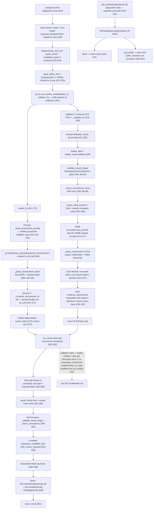

# Procurement Evidence Verifier (PEV)

An Intelligent Contract for GenLayer that evaluates whether a vendor proposal contains textual evidence supporting procurement specification requirements.

> **Version: V5 (2026-11-21).** V5 answers the Oct 31, 2026 rejection of the V4 submission: V4's validator only checked the leader result's structure, so opposite assessments could both pass. In V5 every validator independently re-evaluates the proposal evidence with its own LLM call and consensus is over the bound (assessment, decision) pair. See [FIX-SUMMARY.md](FIX-SUMMARY.md) for what changed and how to deploy and resubmit. The V4 Studio results below are kept as a historical record.

## Project Overview

PEV (Procurement Evidence Verifier) is a GenLayer Intelligent Contract prototype designed to evaluate procurement proposals against specification requirements. The contract determines whether submitted textual evidence in a proposal supports, partially supports, contradicts, or fails to establish each requirement.

## Problem Statement

Procurement teams manually review vendor proposals to verify compliance with specification requirements. This process is time-consuming and prone to human inconsistency. PEV automates the evidence evaluation step, providing a structured, deterministic decision output based on LLM-assisted semantic evaluation and storage of results in contract state.

## Why PEV Matters

- **Deterministic decision logic**: The final decision (accept / reject / review) is computed deterministically inside the contract from the LLM-evaluated evidence fields, not by the LLM directly.
- **Deterministic quote verification**: The contract checks whether a candidate quote exists verbatim in the proposal text, independent of LLM output.
- **Contract-state storage**: Evaluation results are stored in contract state as JSON-serialized records, keyed by proposal ID. (Whether this state resides on-chain depends on the deployment environment; this repository contains no deployment record that establishes on-chain storage.)
- **No compliance claims**: The contract records evidence characteristics only; it does not certify real-world compliance, legal validity, or security.

## Architecture



### Contract State

| Field | Type | Description |
|-------|------|-------------|
| `evaluations` | `TreeMap[str, str]` | Persistent storage mapping proposal_id to JSON-serialized result |

### Contract Methods

| Method | Decorator | Parameters | Returns |
|--------|-----------|------------|---------|
| `compute` | `@gl.public.write` | `proposal_id`, `requirement`, `proposal`, `candidate_quote` | `dict` with evaluation result |
| `get_evaluation` | `@gl.public.view` | `proposal_id` | `dict` (stored result), or `None` if no result is stored; raises `gl.vm.UserError` if the stored JSON is corrupted |

## How It Works

### 1. Input Validation

All inputs (`proposal_id`, `requirement`, `proposal`, `candidate_quote`) are validated as strings where required. `proposal_id` and `requirement` must be non-empty. `candidate_quote` may be empty. `proposal` must be at most 50,000 characters (`MAX_PROPOSAL_LENGTH`); `compute()` raises `gl.vm.UserError("proposal exceeds maximum length")` when it exceeds the limit.

### 2. Deterministic Quote Check (`quote_exists`)

The contract checks whether `candidate_quote` appears as a literal substring in `proposal`. This check is:
- **Deterministic**: Same inputs always produce the same result
- **Independent**: Computed outside the LLM prompt
- **Non-conclusive**: `quote_exists=False` does not mean no other evidence exists in the proposal

### 3. Leader Function (Semantic Evaluation)

The leader executes `gl.nondet.exec_prompt()` with a structured prompt built by the shared helper `_build_assessment_prompt()` (contract lines 105–127) — the **same** prompt the validator uses, byte-for-byte, so the validator re-runs the same task. The prompt:
- Presents the requirement and proposal as untrusted data
- Explicitly instructs the LLM to ignore any instructions embedded in the proposal
- Requests JSON output with: `evidence_assessment`, `semantic_relevance`, `evidence_found`, `explanation`
- Explicitly states: "Do not return a decision field; the contract derives it deterministically"

The leader's output is parsed and validated by the shared helper `_parse_assessment()` (contract lines 130–153), which the validator also uses for its own output, so both sides apply identical parsing and validation.

### 4. Validator Function (Independent Re-Evaluation — V5)

The validator receives the leader's result as a `gl.vm.Return` object and reads the payload from its `.calldata` attribute. The logic lives in the module-level `_validator_fn()` (contract lines 173–230); `compute()` passes a thin closure over it so the validator is directly unit-testable (see `tests/test_pev_v5_validator.py`). It runs in two stages:

**Stage 1 — deterministic checks (unchanged from V4):**

1. The argument is a `gl.vm.Return` (otherwise it returns `False`).
2. `.calldata` is readable (failure returns `False`).
3. Result shape: the payload is a dict with `evidence_assessment`, `semantic_relevance`, `evidence_found`, and `decision`; field types and allowed enum values are checked, and `explanation` is checked to be a string within the length limit (type/length check only, not a semantic check).
4. Decision-table consistency: `decision` must equal the value the deterministic decision table computes from the other fields.
5. Cross-field consistency rules (e.g. `supported` requires `evidence_found = true` and cannot combine with `irrelevant`).
6. `quote_exists` must be present, must be a boolean, and must equal the deterministic value computed in `compute()` before the nondeterministic execution.

**Stage 2 — independent semantic re-evaluation (new in V5):**

7. The validator issues its **own** `gl.nondet.exec_prompt()` call with the shared `_build_assessment_prompt()` — the same task the leader ran — and parses its own output with the shared `_parse_assessment()`. If its own LLM call fails, returns malformed JSON, or is missing/invalid fields, it returns `False` (disagree rather than agree on broken output).
8. It derives its **own** decision from its own assessment via the same deterministic table, and accepts the leader's result only if its own decision **equals** the leader's decision.
9. It accepts only if its own `evidence_assessment` is **compatible** with the leader's: identical, or both in the review class (`partial` / `insufficient` / `ambiguous`). The `explanation` free-text field is deliberately not compared (two LLMs word reasoning differently).

The validator returns a single boolean verdict: `True` only if all checks pass; each explicit failure branch returns `False` without raising. It does not read or write contract storage.

**Why this answers the rejection:** V4's validator passed any structurally valid result, so a leader returning `supported → accept` and a leader returning `contradicted → reject` for the same proposal both passed. In V5 a validator that independently assesses `contradicted` derives `reject` and votes `False` against a leader claiming `supported → accept`, and vice versa — opposite assessments can no longer both pass. Within the review class, `partial` vs `insufficient` vs `ambiguous` all mean the same outcome (the evidence does not establish the requirement; a human must review), so requiring byte-identical labels there would make honest validators disagree constantly and stall consensus; the equivalence rule binds what matters (the decision and the assessment class) and tolerates immaterial wording-level variance inside one class.

### 5. Finalization in `compute()`

`compute()` calls `gl.vm.run_nondet_unsafe(leader_fn, validator_fn)`, passing both functions as callbacks to the nondeterministic execution wrapper. The leader's result reaches the two sides in different forms:

- Inside `validator_fn` it arrives wrapped as a `gl.vm.Return` and is read via `.calldata`.
- `compute()` receives `run_result` as a plain `dict`.

`compute()` then re-validates the result deterministically before assembling anything to store: it checks that `run_result` is a dict containing the required fields, that `quote_exists` is a boolean equal to the value `compute()` itself computed, and re-runs the shape and consistency checks. Only then are `evaluation_complete` and `review_required` computed, the final result dict assembled, the result stored as JSON in `TreeMap[str, str]`, and the dict returned.

When a validator returns `False`, GenLayer's documented behavior is leader rotation and retry; if consensus still cannot be reached the transaction goes undetermined and no state is modified. That runtime reaction has not yet been verified against a live V5 deployment (see FIX-SUMMARY.md); the local stub models it as a failed `compute()` with nothing stored, which is covered by the end-to-end disagreement test.

## Decision Logic

The contract uses a deterministic decision table computed inside the contract (not by the LLM):

| evidence_assessment | semantic_relevance | evidence_found | decision |
|---------------------|-------------------|----------------|----------|
| supported | relevant | true | **accept** |
| contradicted | any | any | **reject** |
| any | irrelevant | any | **reject** |
| supported | relevant | false | **review** |
| partial | any | any | **review** |
| insufficient | any | any | **review** |
| ambiguous | any | any | **review** |

The `decision` field is computed locally by the contract, not returned by the LLM. This prevents LLM output variance from affecting the `decision` field itself; which table row applies still depends on the LLM-evaluated fields, so variance in those fields can change the outcome.

## Evidence Assessment

| Status | Meaning |
|--------|---------|
| `supported` | Evidence clearly satisfies the requirement |
| `partial` | Evidence addresses part of the requirement |
| `contradicted` | Evidence directly contradicts the requirement |
| `insufficient` | Evidence relevant but doesn't establish the requirement |
| `ambiguous` | Requirement or evidence too ambiguous to judge |

### Semantic Relevance Values

`semantic_relevance` is one of three values (contract: `ALLOWED_RELEVANCE`):

| Value | Effect in the decision table |
|-------|------------------------------|
| `relevant` | Required, together with `supported` and `evidence_found=true`, for `accept` |
| `irrelevant` | Always results in `reject`, regardless of the other fields |
| `uncertain` | Does not enable `accept` and does not by itself force `reject`; with a non-`contradicted` assessment it falls through to `review` |

### Result Flags: `evaluation_complete` and `review_required`

Both are computed deterministically inside `compute()` from the validated result fields:

- **`evaluation_complete`** is `True` only when all four result fields are within their allowed domains: `evidence_assessment` is an allowed status, `semantic_relevance` is an allowed value, `evidence_found` is a boolean, and `decision` is an allowed decision value. It is a field-domain check; it does not verify factual correctness of the evaluation.
- **`review_required`** is `True` when the evaluation is incomplete, or when `decision` is `review`, or when `evidence_assessment` is `insufficient` or `ambiguous`. A clear `reject` (for example, contradicted evidence) does not by itself set `review_required`.

## Equivalence Principle

GenLayer's equivalence principle requires nondeterministic code paths to be checkable by validators. V4 kept the validator itself deterministic, which the Oct 31, 2026 rejection identified as the flaw: a validator that only checks output shape "is not performing consensus" (GenLayer Equivalence Principle documentation). **V5 makes the validator intentionally nondeterministic**: each validator re-runs the same LLM task as the leader and consensus is over the bound (assessment, decision) pair. What the code establishes:

1. **Deterministic fields**: `quote_exists`, `input_within_limit`, `evaluation_complete`, `review_required` are computed deterministically inside `compute()` from the inputs, not from LLM output.
2. **The LLM supplies evidence fields only**: `evidence_assessment`, `semantic_relevance`, `evidence_found`, and `explanation` are produced by the LLM — once by the leader, and once independently by each validator, using the same shared prompt (`_build_assessment_prompt`) and the same shared parsing/validation (`_parse_assessment`). The validator compares only the stable decision fields (its own derived decision and its own `evidence_assessment`, with review-class equivalence); `explanation` free text is never compared, following GenLayer's "partial field matching" pattern.
3. **Decision derived locally**: The `decision` field is never returned by the LLM; it is computed by the contract from the evidence fields using a deterministic table — identically on the leader side and on each validator side.

What this section does not claim: that all validator outputs are identical across validators (LLM wording variance is expected and is why review-class equivalence exists), or that the runtime provides specific consensus guarantees beyond its documented leader-rotation behavior.

## Testing Results

### Local Tests — Executed (V5, Python standard-library `unittest`)

Executed with `python -m unittest tests.test_pev_direct tests.test_pev_v5_validator` (from the repository root, Python 3.12.3, 2026-11-21). **Total: 32 tests — 32 passed, 0 failed, 0 errors, 0 skipped.**

The contract imports the `genlayer` package, which is not installable locally (the `genlayer` package on PyPI is an intentionally empty placeholder, and `gltest` is not published on PyPI at all). The tests therefore run against a stdlib-only stub (`tests/genlayer_stub.py`) injected into `sys.modules` before the contract is imported. The stub provides no-op `gl.public` decorators, a plain-dict `evaluations` store, `gl.vm.UserError` / `gl.vm.Return`, a scripted `gl.nondet.exec_prompt` (responses served from a test-controlled queue, every prompt recorded), and a `gl.vm.run_nondet_unsafe` that runs the leader then the validator and raises on a `False` verdict (modelling "no consensus, no state modified"). The stub is test tooling only and is not part of the deployed contract.

| Suite | Tests | Result |
|-------|-------|--------|
| `tests/test_pev_direct.py` — deterministic logic + decision table | 10 | All pass. The 4 decision-table tests were fixed in V5: V4 called `contract._compute_decision(...)`, but `_compute_decision` is a module-level function, not a method; they now import it directly. |
| `tests/test_pev_v5_validator.py` — rejection scenarios + end-to-end | 22 | All pass. See below. |

**V5 rejection-scenario tests (22):**

| # | Test | What it proves | Result |
|---|------|----------------|--------|
| 1 | `test_opposite_supported_leader_contradicted_validator` | Leader `supported → accept` vs validator `contradicted → reject`: validator False (the exact rejected failure mode) | PASS |
| 2 | `test_opposite_contradicted_leader_supported_validator` | Reverse direction: validator False | PASS |
| 3 | `test_agreement_accept` | Both `supported → accept`: True | PASS |
| 4 | `test_agreement_reject` | Both `contradicted → reject`: True | PASS |
| 5 | `test_agreement_reject_irrelevant` | Both `irrelevant → reject`: True | PASS |
| 6 | `test_review_class_partial_vs_insufficient` | Leader `partial → review`, validator `insufficient → review`: True | PASS |
| 7 | `test_review_class_insufficient_vs_ambiguous` | Leader `insufficient → review`, validator `ambiguous → review`: True | PASS |
| 8 | `test_review_vs_decisive_disagrees` | Leader `partial → review`, validator `supported → accept`: False | PASS |
| 9 | `test_supported_review_vs_partial_review_disagrees` | Both derive `review`, but leader says `supported` and validator says `partial`: False (`supported` is not in the review class) | PASS |
| 10 | `test_validator_malformed_json` | Validator's own LLM returns malformed JSON: False | PASS |
| 11 | `test_validator_missing_field` | Validator's own LLM omits `evidence_found`: False | PASS |
| 12 | `test_validator_invalid_enum` | Validator's own LLM returns an invalid assessment label: False | PASS |
| 13 | `test_leader_decision_inconsistent_with_table` | Leader decision contradicts the table: False, and no LLM call is issued (structural failure short-circuits) | PASS |
| 14 | `test_quote_exists_mismatch` | Leader `quote_exists` differs from `compute()`'s value: False | PASS |
| 15 | `test_leader_result_not_a_return` | Leader result not wrapped in `gl.vm.Return`: False | PASS |
| 16 | `test_leader_supported_without_evidence_found` | Leader `supported` + `evidence_found=False` fails the cross-field rule: False | PASS |
| 17 | `test_leader_missing_quote_exists` | Leader result without `quote_exists`: False | PASS |
| 18 | `test_agreement_stores_evaluation` | End-to-end agreement: `compute()` stores and `get_evaluation` returns the result | PASS |
| 19 | `test_leader_and_validator_prompts_identical` | Leader and validator prompts are byte-identical (same shared prompt) | PASS |
| 20 | `test_disagreement_stores_nothing` | End-to-end disagreement: `compute()` fails, nothing stored | PASS |
| 21 | `test_review_class_agreement_end_to_end` | Leader `partial`, validator `insufficient`: stored as `review` | PASS |
| 22 | `test_get_evaluation_unknown_id` | Unknown proposal_id returns `None` | PASS |

**Execution notes:**

1. Command: `python -m unittest tests.test_pev_direct tests.test_pev_v5_validator` (single local run in this environment; no CI or automated execution artifact is committed to the repository). `python -m unittest discover -s tests` gives the same 32/32 result.
2. Tests 5 and 6 of `test_pev_direct.py` (`test_evaluation_complete_*`) remain **illustrative re-implementations**: they re-implement a field-presence check and do **not** import or exercise the contract's actual `evaluation_complete` logic.
3. The stub models validator disagreement as a failed `compute()`; the real runtime rotates the leader and retries, and only goes undetermined if consensus cannot be reached. The observable local outcome is the same (nothing stored), but the live-network reaction still needs verification against a deployed V5 contract (see FIX-SUMMARY.md).

### Manual GenLayer Studio Tests — Executed Results (V4)

The 13 planned Studio cases have now been exercised against the deployed V4
contract. Detailed observed outputs and limitations are recorded in the
**Manual GenLayer Studio Results (PEV-M01–PEV-M13)** section below. V5 adds
new Studio cases M14–M16 (opposite-assessment disagreement, review-class
equivalence, validator malformed-output disagreement) in
`docs/manual_studio_test_plan.md`; they are unexecuted until V5 is deployed.

Summary:
- M01–M08: successful execution and expected observed decisions.
- M09–M10: NOT VERIFIED; malformed or incomplete LLM output was not demonstrated.
- M11: execution succeeded, but the intended validator-False behavior was not verified.
- M12: PASS; the 50,001-character proposal was rejected with the expected UserError.
- M13: execution and storage succeeded, but the assessment was `partial` rather than the expected `ambiguous`; this is an expectation mismatch, not a full pass.

### Test Status Summary

| Category | Count | Status |
|----------|-------|--------|
| Local tests (`test_pev_direct.py` + `test_pev_v5_validator.py`) | 32 | All pass (V5, 2026-11-21); two `test_pev_direct.py` tests are illustrative re-implementations, not direct contract tests |
| Manual Studio cases (V4, M01–M13) | 13 | Executed against V4; M01–M08 and M12 passed, M09–M10 unverified, M11 target unverified, M13 expectation mismatch |
| Manual Studio cases (V5, M14–M16) | 3 | Planned in `docs/manual_studio_test_plan.md`; unexecuted until V5 is deployed |

**Test framework**: Python standard-library `unittest` (`tests/test_pev_direct.py`, `tests/test_pev_v5_validator.py`, stub `tests/genlayer_stub.py`).

## Installation and Usage

### Prerequisites

- Python 3.14+
- GenLayer SDK (`genlayer` package) — availability for Python 3.14.6 on Android Termux not verified
- `gltest` CLI tool — availability not verified

### Installation

Dependencies are not pinned in `requirements.txt` because the GenLayer SDK (`genlayer`) and testing tool (`gltest`) have not been verified for availability or compatibility with Python 3.14.6 on this environment. Refer to official GenLayer documentation for installation instructions.

### Contract Deployment

Deployment commands are not documented here because the official GenLayer deployment procedure has not been verified in this environment. Refer to official GenLayer documentation.

### Contract Invocation (API-shape reference only)

The example below shows the call shape. It is **not** a verified local invocation: `compute()` calls `gl.nondet.exec_prompt`, which requires a GenLayer runtime, so plain local Python execution of this example is not verified in this environment.

```python
from contracts.pev_contract import PEVContract

contract = PEVContract()
result = contract.compute(
    proposal_id="PROP-001",
    requirement="System shall use AES-256 encryption at rest",
    proposal="We implement AES-256 encryption for data at rest.",
    candidate_quote="AES-256 encryption at rest"
)
print(result)
```

### Retrieving an Evaluation (API-shape reference only)

Same caveat: `get_evaluation` reads contract state, which is maintained by the GenLayer runtime.

```python
result = contract.get_evaluation("PROP-001")
print(result)
```

## Limitations

1. **GenLayer SDK dependency**: The `genlayer` package has not been verified as available for Python 3.14.6 on Android Termux.
2. **Android Termux compatibility**: Not verified for ARM architecture.
3. **No formal security audit**: This contract has not undergone professional security review.
4. **Single requirement per evaluation**: Each `compute()` call evaluates one requirement against one proposal.
5. **No batch evaluation**: Multiple requirements require multiple contract calls.
6. **LLM-based semantic evaluation**: The `evidence_assessment`, `semantic_relevance`, and `evidence_found` fields are produced by an LLM and may vary between executions; they are validated for structure and consistency but not for factual correctness.
7. **V5 validator cost**: every validator now issues its own LLM call per `compute()` (that is the intended GenLayer comparative model — 5 validators, 5 independent assessments — and is what makes the vote carry judgment). The V5 validator's live-network behavior (leader rotation on a majority-False verdict) is documented, not yet empirically verified.

## License

The license for this project has not been determined. No LICENSE file is included.

---

**Important**: This contract evaluates textual evidence only. It does not certify real-world compliance, legal validity, or security of vendor proposals. All evaluations are subject to GenLayer's equivalence principle and should be reviewed by human reviewers for final decisions.
## Manual GenLayer Studio Results (PEV-M01–PEV-M13)

All cases below were executed against the already deployed V4 contract.
These are documentation-only test records; the deployed contract was not modified.
V5 adds Studio cases M14–M16 in `docs/manual_studio_test_plan.md`; they apply
to the new V5 deployment, not to V4.

| Case | Scenario | Studio execution | Observed result | Assessment |
|---|---|---|---|---|
| M01 | AES-256 scope ambiguity | FINALIZED / SUCCESS / MAJORITY_AGREE | REVIEW, partial, relevant | PASS — expected review |
| M02 | Explicit SAML contradiction | FINALIZED / SUCCESS / MAJORITY_AGREE | REJECT, contradicted | PASS |
| M03 | Log retention duration missing | FINALIZED / SUCCESS / MAJORITY_AGREE | REVIEW, insufficient | PASS |
| M04 | Candidate quote absent | FINALIZED / SUCCESS / MAJORITY_AGREE | REVIEW; quote_exists=false | PASS |
| M05 | Irrelevant AES quote for API versioning | FINALIZED / SUCCESS / MAJORITY_AGREE | REJECT, irrelevant | PASS |
| M06 | Explicit SSO support | FINALIZED / SUCCESS / MAJORITY_AGREE | ACCEPT, supported | PASS |
| M07 | Uptime target missing | FINALIZED / SUCCESS / MAJORITY_AGREE | REVIEW, insufficient | PASS |
| M08 | Explicit plaintext contradiction | FINALIZED / SUCCESS / MAJORITY_AGREE | REJECT, contradicted | PASS |
| M09 | Malformed LLM response | Not demonstrated | Requires malformed model output and UserError evidence | NOT VERIFIED |
| M10 | Missing required LLM fields | Not demonstrated | Requires missing-field model output and UserError evidence | NOT VERIFIED |
| M11 | Validator disagreement / False verdict | FINALIZED / SUCCESS / MAJORITY_AGREE | ACCEPT; no confirmed final False verdict | TARGET NOT VERIFIED |
| M12 | Oversized proposal (50,001 chars) | FINALIZED / ERROR | UserError: proposal exceeds maximum length; no output | PASS |
| M13 | Ambiguous requirement | FINALIZED / SUCCESS / MAJORITY_AGREE | REVIEW, partial, relevant | EXPECTATION MISMATCH |

For M01–M08, the recorded `get_evaluation` results matched the corresponding
`compute` outputs. M11 also had a matching stored evaluation, but its intended
validator-False behavior was not demonstrated. M13 completed successfully at
the execution and storage levels, but returned `partial` rather than the
expected `ambiguous`; it must not be counted as a full expected-behavior pass.

Important interpretation notes:
- In M03, `quote_exists=true` means the candidate sentence was found literally;
  `evidence_found=false` means it did not establish the required 90-day period.
- In M08, `quote_exists=true` and `evidence_found=false` are compatible: the
  quote exists, but it is evidence contradicting the requirement.
- In M05, the observed output included `review_required=true` alongside
  `decision=reject`; this is recorded as observed, not silently normalized.
- M12 ended with transaction status FINALIZED but execution result ERROR.
  FINALIZED does not mean the contract call succeeded.
- M09 and M10 remain unverified because ordinary inputs do not guarantee
  malformed or incomplete LLM output.
